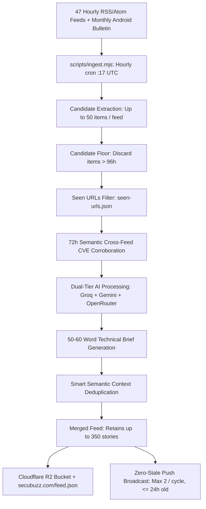

# SecuBuzz Active Feeds & Threat Intelligence Sources Directory

This document provides the authoritative, single source of truth for all active news feeds, official vendor PSIRT bulletins, security advisory databases, and threat telemetry powering the SecuBuzz ecosystem.

Last Updated: November 2026 | Total Active Sources: 49 Hourly Feeds + 33 Vendor Outage Radars + Android Security Bulletin (Monthly) + 2 Advisory Databases (1,806 Tracked Advisories) + FIRST.org EPSS Radar

---

## 1. Active News Feeds: Industry, Threat Research & Supply Chain (33 Sources)
Ingested hourly by `scripts/ingest.mjs` running on GitHub Actions (`cron: "17 * * * *"`). Each raw item is filtered, cross-corroborated, deduplicated, and converted by resilient tri-engine AI (Groq `openai/gpt-oss-20b` + Google Gemini `gemini-2.5-flash` + OpenRouter fallback) into concise, 60-word security briefs classified by Threat Severity (`CRITICAL`, `HIGH`, `MEDIUM`, `LOW`) and Category (`Breach`, `Ransomware`, `CVE`, `Vulnerability`, `Nation State`, `General`).

| # | Source Name | Feed URL | Primary Focus |
|---|---|---|---|
| **1** | **The Hacker News** | `https://feeds.feedburner.com/TheHackersNews` | General cyber attacks, zero-days, exploit discoveries |
| **2** | **BleepingComputer** | `https://www.bleepingcomputer.com/feed/` | Ransomware, active campaigns, tech security updates |
| **3** | **CISA Alerts** | `https://www.cisa.gov/cybersecurity-advisories/all.xml` | U.S. Federal Government security & ICS advisories |
| **4** | **Krebs on Security** | `https://krebsonsecurity.com/feed/` | Investigative cybercrime, breaches, financial fraud |
| **5** | **SANS Internet Storm Center** | `https://isc.sans.edu/rssfeed_full.xml` | Network incident handling, threat diaries, honeypot telemetry |
| **6** | **Unit 42 (Palo Alto)** | `https://unit42.paloaltonetworks.com/feed/` | APT research, malware reverse engineering, threat actors |
| **7** | **Zero Day Initiative (ZDI)** | `https://www.zerodayinitiative.com/blog?format=rss` | Zero-day vulnerability disclosures, patch analysis |
| **8** | **The Record by Recorded Future** | `https://therecord.media/feed/` | Geopolitical cybersecurity, state-sponsored campaigns |
| **9** | **SecurityWeek** | `https://www.securityweek.com/feed/` | Enterprise risk, industry breaches, defense tech |
| **10** | **Dark Reading** | `https://www.darkreading.com/rss.xml` | Information security community, vulnerability research |
| **11** | **Help Net Security** | `https://www.helpnetsecurity.com/feed/` | Technical cybersecurity tutorials, tool releases |
| **12** | **CyberNews AI** | `https://www.cybernewsai.com/feed.xml` | AI security, deepfakes, algorithmic risks |
| **13** | **Microsoft Security Blog** | `https://www.microsoft.com/security/blog/feed/` | Windows/Azure threats, security research |
| **14** | **Google Security Blog** | `https://security.googleblog.com/feeds/posts/default` | Android, Chrome, cloud security research |
| **15** | **Sophos Threat Research** | `https://news.sophos.com/en-us/category/threat-research/feed/` | Endpoint defense, active adversary reports |
| **16** | **Check Point Research** | `https://research.checkpoint.com/feed/` | Malware reverse engineering, threat intelligence |
| **17** | **CrowdStrike Blog** | `https://www.crowdstrike.com/blog/feed/` | EDR intelligence, nation-state adversary tracking |
| **18** | **The DFIR Report** | `https://thedfirreport.com/feed/` | Real-world intrusion case studies, forensic timelines |
| **19** | **Wiz Research** | `https://www.wiz.io/blog/rss.xml` | Cloud infrastructure vulnerabilities (AWS, GCP, Azure) |
| **20** | **Cloudflare Security** | `https://blog.cloudflare.com/rss/` | DDoS trends, web application firewalls, edge security |
| **21** | **Cisco Talos** | `https://blog.talosintelligence.com/rss/` | Nation-state campaigns, malware IOCs, exploit telemetry |
| **22** | **Trend Micro Research** | `https://feeds.feedburner.com/TrendMicroResearch` | Vulnerability research, rootkit/ransomware investigations |
| **23** | **SentinelOne** | `https://www.sentinelone.com/blog/feed/` | Endpoint threat research, nation-state actor profiles |
| **24** | **Schneier on Security** | `https://www.schneier.com/feed/atom/` | Cryptography, privacy, and strategic security policy |
| **25** | **Malwarebytes Labs** | `https://www.malwarebytes.com/blog/feed/index.xml` | Threat intelligence, malicious infrastructure tracking |
| **26** | **ESET WeLiveSecurity** | `https://www.welivesecurity.com/en/rss/feed/` | Global APT analysis, spyware campaigns, wiper malware |
| **27** | **Cyber Security News** | `https://feeds.feedburner.com/cyber-security-news` | Active zero-days, ransomware intrusion techniques, tool updates |
| **28** | **Google Project Zero** | `https://projectzero.google/feed.xml` | Deep root-cause zero-day exploit teardowns & research |
| **29** | **Google Threat Intelligence** | `https://cloudblog.withgoogle.com/topics/threat-intelligence/rss/` | Mandiant & Google TAG nation-state APT campaigns, cloud resource hijacking, and cyber espionage telemetry |
| **30** | **GreyNoise Labs** | `https://www.greynoise.io/blog/rss.xml` | Mass internet exploit spray, honeypot telemetry, scanner profiling |
| **31** | **Socket.dev** | `https://socket.dev/api/blog/feed.atom` | Open source supply chain security, malicious npm/PyPI packages |
| **32** | **Huntress** | `https://www.huntress.com/blog/rss.xml` | Incident research, active intrusion analysis, MSP ecosystem defense |
| **33** | **Arctic Wolf** | `https://arcticwolf.com/feed/` | Adversary research, real-world breach response, initial access trends |

---

## 2. Active Vendor PSIRT & Security Release Feeds (16 Official Platforms & Advisories)
These official Product Security Incident Response Team (PSIRT) and official vendor security release feeds provide direct, authoritative dispatches directly from platform vendors before secondary journalism reports them. They serve as the foundational pipeline for the upcoming **P0: "My Stack / Am I Affected?"** enterprise personal radar.

| # | Vendor / Platform | Feed URL | Primary Focus & Ecosystem |
|---|---|---|---|
| **34** | **Palo Alto Networks PSIRT** | `https://security.paloaltonetworks.com/rss.xml` | PAN-OS, GlobalProtect, Prisma Access, Cortex XDR |
| **35** | **Fortinet FortiGuard PSIRT** | `https://fortiguard.fortinet.com/rss/ir.xml` | FortiOS, FortiGate, FortiManager, FortiAnalyzer |
| **36** | **Cisco PSIRT** | `https://tools.cisco.com/security/center/psirtrss20/CiscoSecurityAdvisory.xml` | Cisco IOS-XE, ASA, Duo, AnyConnect, Catalyst |
| **37** | **Ivanti Security Advisories** | `https://www.ivanti.com/blog/topics/security-advisory/rss` | Connect Secure (ICS), EPMM, Policy Secure, Neurons |
| **38** | **Microsoft MSRC** | `https://api.msrc.microsoft.com/update-guide/rss` | Patch Tuesday, Windows Server, Exchange, Entra ID, Hyper-V |
| **39** | **Red Hat Security Advisories** | `https://access.redhat.com/security/data/metrics/rhsa.rss` | RHEL, OpenShift, Ansible, JBoss enterprise packages |
| **40** | **Google Chrome Releases** | `https://feeds.feedburner.com/GoogleChromeReleases` | V8 engine zero-days, Chromium browser security fixes |
| **41** | **AWS Security Bulletins** | `https://aws.amazon.com/security/security-bulletins/feed/` | Cloud infrastructure vulnerabilities, AWS SDKs, Linux AMIs |
| **42** | **GitLab Security Releases** | `https://docs.gitlab.com/releases/patch-releases.xml` | GitLab Community & Enterprise edition critical RCE patches |
| **43** | **Ubuntu Security Notices** | `https://usn.ubuntu.com/rss.xml` | Canonical Linux kernel vulnerabilities, server packages |
| **44** | **Apple Security Updates** | `https://developer.apple.com/news/releases/rss/releases.rss` | iOS, iPadOS, macOS, Safari WebKit active zero-days |
| **45** | **GitHub Security Blog** | `https://github.blog/security/feed/` | Software supply chain, GitHub Actions security, Dependabot |
| **46** | **ZDI Published Advisories** | `https://www.zerodayinitiative.com/rss/published/` | Raw coordinated zero-day vulnerability disclosures & CVE advisories |
| **47** | **CERT-EU Security Advisories** | `https://cert.europa.eu/publications/security-advisories-rss` | Authoritative EU institutional threat alerts & critical vulnerability notices |
| **48** | **Oracle Security Alerts** | `https://www.oracle.com/ocom/groups/public/@otn/documents/webcontent/rss-otn-sec.xml` | Oracle Critical Patch Updates (CPU), Database, WebLogic, Java SE alerts |
| **49** | **Canadian Centre for Cyber Security** | `https://www.cyber.gc.ca/api/cccs/atom/v1/get?feed=alerts_advisories&lang=en` | Cyber Centre (CCCS) official Canadian national cyber defense alerts & enterprise advisories |

### Monthly Batch Pipeline: Android Security Bulletin (#50)
- **Source**: Android Open Source Project (AOSP) Security Bulletins (`source.android.com/docs/security/bulletin`)
- **Cadence**: Monthly batch on the 5th of each month via `.github/workflows/asb.yml`.
- **Scope**: Framework, System, Media, Linux kernel, Qualcomm, MediaTek, and Arm CVE patch level summaries.

---

## 3. Active Threat Advisories Catalogs (1,806 Tracked Advisories)
These feeds power the **Advisories Tab** on both the mobile app and website, merged and deduplicated by CVE ID, with full offline caching via `AsyncStorage` (`@secubuzz_advisories_v2`).

### A. CISA Known Exploited Vulnerabilities (KEV) Catalog (1,756 Advisories)
- **Feed Endpoint**: `https://www.cisa.gov/sites/default/files/feeds/known_exploited_vulnerabilities.json`
- **Cadence**: Live on app launch & pull-to-refresh; background cached.
- **Data Provided**:
  - Confirmed active zero-days actively exploited in enterprise networks in the wild.
  - Known ransomware campaign association (`Known` vs `Unknown`).
  - U.S. Federal Government remediation deadlines under Binding Operational Directives (BOD 22-01 / BOD 26-04).
  - Direct vendor patch instructions and authoritative NVD reference links.

### B. GitHub Global Security Advisories (50 Ecosystem Advisories)
- **Feed Endpoint**: `https://api.github.com/advisories?per_page=50`
- **Cadence**: Live on app launch & pull-to-refresh; background cached.
- **Data Provided**:
  - Open-source software ecosystem vulnerabilities across Go, npm, Python (PyPI), Java (Maven), RubyGems, .NET (NuGet), and Rust (Cargo).
  - Exact first patched version (`Upgrade to vX.X.X or later`).
  - Vulnerable version ranges and CWE classification.
  - CVSS v3 and CVSS v4 severity metrics.

### C. FIRST.org EPSS (Exploit Prediction Scoring System) Telemetry
- **Proxy Endpoint**: `https://secubuzz.com/api/epss?cve={CVE-ID}`
- **Data Source**: FIRST.org EPSS Live API.
- **Cadence**: Edge-cached for 24 hours in Cloudflare Worker.
- **Data Provided**:
  - 30-day in-the-wild exploitation probability (e.g. `0.941` = 94.1% probability of weaponized exploitation in the wild).
  - Global threat percentile ranking across all published CVEs (e.g. `98th percentile`).
  - Rendered dynamically on CVE detail screens and advisory cards with zero synthetic data.

---

## 3. Real-Time Vendor Outages & Infrastructure Health Radar (33 Providers)
Monitored continuously at the Cloudflare Worker edge (`/api/vendor-status`), cached for 5 minutes, and auto-refreshed by web clients every 3 minutes. Evaluates Statuspage.io APIs, StatusHub, custom JSON endpoints, live RSS feeds, and targeted HTML extractors.

| # | Vendor / Platform | Official Status URL | Telemetry Integration |
|---|---|---|---|
| **1** | **1Password** | `https://status.1password.com/` | Statuspage API (`/api/v2/summary.json`) |
| **2** | **Apple** | `https://www.apple.com/support/systemstatus/` | System status developer JSON |
| **3** | **Atlassian (Jira/Confluence)** | `https://status.atlassian.com/` | Statuspage API |
| **4** | **AWS (Amazon Web Services)** | `https://health.aws.amazon.com/health/status` | AWS Service Health RSS / JSON |
| **5** | **Azure** | `https://azure.status.microsoft/en-us/status` | Dedicated Azure RSS Incident feed (`/status/feed/`) |
| **6** | **Broadcom / VMware** | `https://status.broadcom.com/` | Statuspage API |
| **7** | **Check Point** | `https://status.checkpoint.com/` | Statuspage API |
| **8** | **Cisco (Duo & Security)** | `https://status.cisco.com/` | Statuspage API |
| **9** | **Citrix Cloud** | `https://status.cloud.com/` | Statuspage API |
| **10** | **Cloudflare** | `https://www.cloudflarestatus.com/` | Statuspage API |
| **11** | **CrowdStrike** | `https://falcon.crowdstrike.com/` | Statuspage API |
| **12** | **CyberArk** | `https://status.cyberark.com/` | Statuspage API |
| **13** | **F5 Networks** | `https://www.f5cloudstatus.com/` | Statuspage API |
| **14** | **Fortinet** | `https://status.fortistatus.com/` | FortiStatus custom status endpoint |
| **15** | **GitHub** | `https://www.githubstatus.com/` | Statuspage API |
| **16** | **GitLab** | `https://status.gitlab.com/` | Statuspage API |
| **17** | **Google Cloud Platform** | `https://status.cloud.google.com/` | Google Cloud Incident JSON |
| **18** | **HashiCorp** | `https://status.hashicorp.com/` | Statuspage API |
| **19** | **Ivanti Cloud** | `https://status.ivanticloud.com/` | StatusHub API (`/api/status/public`) |
| **20** | **Microsoft 365** | `https://status.cloud.microsoft` | Microsoft 365 Status service API |
| **21** | **Okta** | `https://status.okta.com/` | Statuspage API |
| **22** | **Oracle Cloud (OCI)** | `https://ocistatus.oraclecloud.com/` | OCI status telemetry JSON |
| **23** | **Palo Alto Networks** | `https://status.paloaltonetworks.com/` | Statuspage API |
| **24** | **Qualys** | `https://status.qualys.com/` | Statuspage API |
| **25** | **Rapid7** | `https://status.rapid7.com/` | Statuspage API |
| **26** | **Red Hat** | `https://status.redhat.com/` | Statuspage API |
| **27** | **SentinelOne** | `https://status.sentinelone.com/` | Statuspage API |
| **28** | **Slack** | `https://status.slack.com/` | Statuspage API |
| **29** | **SonicWall** | `https://status.sonicwall.com/` | Statuspage API |
| **30** | **Sophos Central** | `https://sophoscentral.status.page/` | Statuspage API |
| **31** | **Tenable** | `https://status.tenable.com/` | Statuspage API |
| **32** | **Trend Micro** | `https://status.trendmicro.com/` | Statuspage API |
| **33** | **Zscaler** | `https://trust.zscaler.com/` | Zscaler Trust RSS / JSON |

---

## 4. Ingestion Cadence, Deduplication & AI Architecture

---

## 5. Architectural Roadmap: Official Red Hat Security Data API Enrichment (v1.1.0)

- **Identified Gap**: Red Hat's official RSS feed (`https://access.redhat.com/security/data/metrics/rhsa.rss`) omits all CVE identifiers from its RSS XML `<description>` (e.g. *RHSA-2026:85930* lists only package names and a generic template pointing readers to the web References section).
- **User Impact**: While enterprise users with `Red Hat` in **My Stack** receive these updates, users monitoring specific CVEs (e.g., `CVE-2026-97689`, `CVE-2026-97687`) in **CVE Watchlist** miss automatic matching because the brief's text lacks explicit CVE tokens.
- **Approved Strategy (v1.1.0)**:
  - **Zero-Scrape Official API**: Utilize Red Hat's official Security Data API / CSAF endpoints (`access.redhat.com/hydra/rest/securitydata/cvrf/{RHSA_ID}.json`) as an isolated pre-enrichment step for incoming RHSA candidates.
  - **Payload Injection**: Automatically inject the authoritative CVE list into the candidate's description before AI summarization, ensuring Groq/Gemini renders interactive, tappable CVE chips for seamless Watchlist triage.
  - **Pipeline Safety**: Maintain code freeze on `scripts/ingest.mjs`; implement as a modular pre-processor or dedicated PSIRT sync harness.

