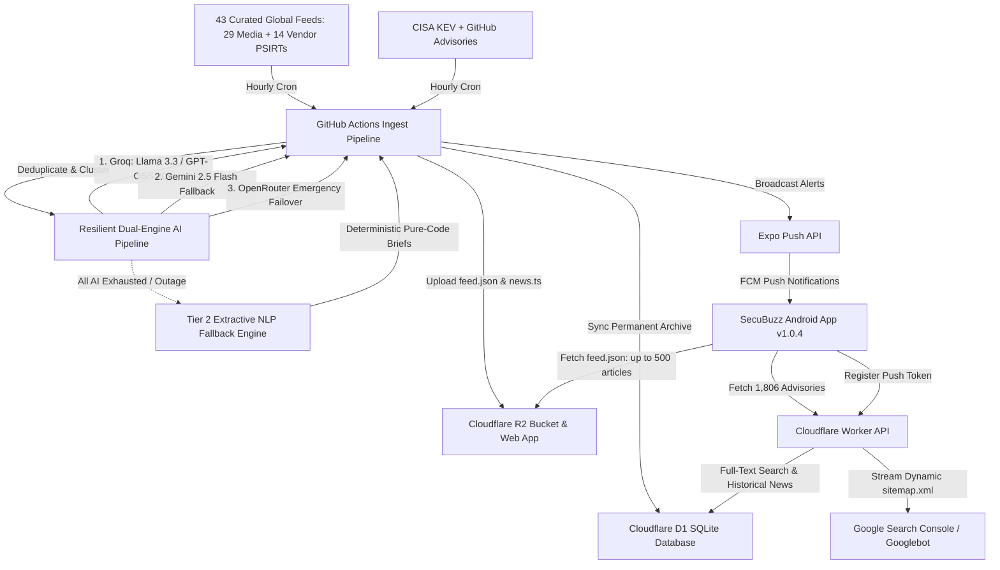

# SecuBuzz: Complete Architectural & Product Status Quo

> **Document Purpose**: This comprehensive status quo dossier details the current architecture, technical stack, threat intelligence pipeline, feature set, design philosophy, telemetry snapshot, and monetization roadmap of **SecuBuzz**. You can copy or feed this document into other AI models (e.g., Claude 3.7, GPT-4o, Gemini 2.5 Pro, DeepSeek R1) to brainstorm features, enterprise extensions, business models, and UX refinements.

---

## 1. Executive Summary & Value Proposition

- **App Name**: SecuBuzz
- **Developer / Publisher**: MiSo Labs
- **Platform**: **Android Native Mobile** via React Native & Expo SDK 57 (Package: `com.secubuzz.app`, **Live on Google Play Store — Version 1.0.4, Version Code 10**) + Web Companion ([secubuzz.com](https://secubuzz.com)).
  - *Platform Scope*: **Strictly Android-only**. No iOS build or iOS support is planned to keep operational overhead at $0.00 and maintain laser focus on Android security professionals.
- **Primary Audience**: Cybersecurity analysts, SOC operators, CISOs, DevSecOps engineers, sysadmins, and technology professionals across 177+ countries.
- **Core Value Proposition**: 
  1. **Zero Fluff**: Cuts through sensationalist news to deliver factual, objective, actionable 60-word security intelligence briefs.
  2. **My Stack & CVE Watchlist**: 1-tap enterprise infrastructure filtering across 16+ enterprise vendors (Cisco, Fortinet, Microsoft, Palo Alto, AWS, Red Hat, Ivanti, Citrix, etc.) and custom CVE pinning.
  3. **In-Story Entity Intelligence**: Interactive, tappable CVE and vendor chips in headlines and summaries for instantaneous triage, feed filtering, and watchlist monitoring.
  4. **Permanent D1 Threat Archive**: Cloudflare D1 historical archive storing 1,356+ verified security articles covering 30+ days of threat history with zero 404s, fast full-text search, and full server-side SEO pre-rendering.
  5. **Real-Time Threat Telemetry**: Dedicated tracking of active zero-days and emergency directives from the **CISA Known Exploited Vulnerabilities (KEV)** catalog and GitHub Security Advisory Database.
  6. **EPSS Exploit Prediction Integration**: Enriches static CVSS vulnerability scores with daily FIRST.org Exploit Prediction Scoring System (EPSS) probabilities and percentile rankings.
  7. **Anti-AI / Executive Aesthetic**: Clean, dark-mode, sober UI without garish neon gradients or emoji clutter (`🚨⚠️`).
  8. **Zero-Leakage Server-Side Push Pager**: Evaluates alerts server-side against configured My Stack enterprise vendors and watched CVEs before FCM dispatch, with instant client sync and zero account friction.
  9. **Hardened Extractive Fallback Engine**: Pure-code Tier 2 deterministic NLP airbag with automatic prompt tag sanitization, continuation bracket stripping, and 100% factual fidelity when cloud AI APIs experience outages.
  10. **100% Free Operation ($0.00 Overhead)**: Engineered entirely on top-tier free cloud tiers with $0.00 monthly infrastructure overhead.

---

## 2. Technology Stack & Infrastructure



### Feed Routing & Non-Colliding Slug Architecture
- **Non-Colliding 8-Hex FNV-1a Slug Engine**: Combines normalized headline base and canonical URL (`${base}|${idStr}`) via 32-bit FNV-1a hash (`0x811c9dc5` seed, `0x01000193` prime) with 8 hex characters (`padStart(8, '0')`), replacing legacy 6-char truncation that suffered from collisions.
- **Permanent Cloudflare D1 Historical Archive**:
  - `articles` table in Cloudflare D1 `secubuzz-push-db` storing **1,356 unique historical articles** spanning past 30 days (October 2 to present).
  - **Zero-404 Edge Resolution**: Every historical article permalink (e.g. `/news/php2shell-exploitation-started-days-before-patches-bd511408`) resolves with `HTTP 200 OK` and server-rendered SEO meta tags + Schema.org `NewsArticle` JSON-LD.
  - **Dynamic Sitemap**: `https://secubuzz.com/sitemap.xml` queries D1 on every request and streams all 1,356 articles to Googlebot alongside all CVE advisories.
  - **Live Historical Search API**: `GET /api/news/search?q=...` provides instantaneous full-text search (<2ms) across the entire 30-day D1 intelligence archive.
- **Feed Retention Expansion**: Active `feed.json` cap expanded from 350 to **500 articles** (~10–14 days of active feed) with automatic post-save hook syncing all new stories to Cloudflare D1.

### Core Frontend Stack
- **Framework**: Expo SDK 57 (`57.0.26`) with React Native (`0.86.3`) and React (`19.2.3`).
- **Target OS**: **Android** (Android 11–15 support, compiled with version code 10 / release 1.0.4).
- **Active Production OTA Update**:
  - Group ID: `af00a700-1db5-4edb-8a95-8c84de403d2f`
  - Android Update ID: `01a19f15-a1ef-74e1-b1bd-c9f65a3e9271`
  - Cloudflare Worker Version: `24683136-c90c-4a94-8b42-67fd5b47232d`
  - Runtime version: `1.0.4`
- **Routing**: Expo Router v57 (file-based navigation with typed routes).
- **Language**: TypeScript 6.0 (`strict: true`, zero type errors).
- **Safe Area Insets**: Dynamic `Math.max(insets.bottom, 20) + 16` padding in `ArticleCard.tsx` and `CveCard.tsx` preventing bottom entity sheets and EPSS modals from overlapping traditional Android 3-button navigation bars (`|||  O  <`).
- **State Management & Persistence**:
  - React Context (`MyStackContext`, `SavedArticlesContext`, `ThemeContext`).
  - `@react-native-async-storage/async-storage` for offline caching of briefs, advisories, bookmarks, preferences, stack configurations, and push tokens.
- **Typography**: `@expo-google-fonts/exo` (Exo Bold, SemiBold, Medium, Regular).
- **Icons**: `@expo/vector-icons` (Ionicons).
- **Sensory & Haptics**: `expo-haptics` (tactile micro-feedback for bookmarking, stack toggling, copying, theme switching, and refresh).

### Backend & Cloud Infrastructure (100% Free Tier Profile)
| Service | Purpose | Free Quota | Current SecuBuzz Consumption | Headroom |
| :--- | :--- | :--- | :--- | :--- |
| **Cloudflare Worker** (`secubuzz-push`) | API routing, full-text search, token registry, sitemap streaming & edge SSR | 100,000 req/day | ~2,500–6,000 req/day | **94.0% buffer remaining** |
| **Cloudflare D1** (`secubuzz-push-db`) | Serverless SQLite database for 1,356 archived articles, tokens & analytics | 5,000,000 reads / 100k writes/day | < 80,000 reads / < 100 writes/day | **98.4% database headroom** |
| **Cloudflare R2** (`secubuzz-feed`) | Object storage hosting `feed.json` (~400 KB) | 10 GB storage / 1,000,000 writes/mo | ~45 MB storage / 720 writes/mo | **99.5% free buffer** |
| **Multi-Engine AI & Extractive Fallback** | Summarizing raw RSS feeds into 60-word briefs with pure-code Tier 2 emergency fallback | Groq, Gemini 2.5 Flash, OpenRouter emergency failover + deterministic NLP engine | ~10–22 batches/day split 50/50; 0 dropped batches on AI outage | **100% resilient ($0.00)** |
| **GitHub Actions** | Automated CI cron running `scripts/ingest.mjs` hourly + 6h Watchdog | 2,000 min/mo (Private Repo) | ~960–1,100 min/month | **900+ minute buffer** |
| **Expo Push Service** | FCM push relay to registered Android devices | Unlimited | Batched in chunks of 100 | **100% free** |

---

## 3. Data Models & Threat Classification

### Article Model (`src/models/article.ts`)
```typescript
export interface Article {
  id: string;                      // Normalized canonical URL or CVE ID
  headline: string;                // Concise, objective editorial headline
  summary: string;                 // 40–60 word security intelligence brief
  sourceName: string;              // Primary publisher (e.g., 'The Hacker News', 'CISA KEV')
  sourceUrl: string;               // Direct canonical link to source advisory
  category: ArticleCategory;       // 'BREACH' | 'RANSOMWARE' | 'CVE' | 'VULNERABILITY' | 'NATION_STATE' | 'GENERAL'
  severity: ArticleSeverity;       // 'CRITICAL' | 'HIGH' | 'MEDIUM' | 'LOW'
  publishedAt: string;             // ISO 8601 timestamp
  // Extended Threat Telemetry:
  requiredAction?: string;         // Mandatory vendor/CISA mitigation action
  dueDate?: string;                // Remediation deadline (e.g., '2026-04-15')
  patchedVersion?: string;         // Fixed software release version
  vulnerableVersionRange?: string; // Vulnerable version scope
  vendorProject?: string;          // Vendor/ecosystem (e.g., 'MikroTik', 'Ivanti', 'Google')
  product?: string;                // Affected software product (e.g., 'RouterOS', 'Chrome')
  additionalSources?: {            // Story clustering & deduplication cross-links
    source: string;
    sourceUrl: string;
  }[];
}
```

### Advisory Model (`src/models/cve.ts`)
```typescript
export type AdvisorySeverity = 'CRITICAL' | 'HIGH' | 'MEDIUM' | 'LOW' | 'UNKNOWN';

export type CveAdvisory = {
  id: string;
  cveID: string;
  source: AdvisorySource;
  vendorProject: string;
  product: string;
  vulnerabilityName: string;
  dateAdded: string;
  severity: AdvisorySeverity;
  shortDescription: string;
  requiredAction?: string;
  dueDate?: string;
  knownRansomwareCampaignUse?: 'Known' | 'Unknown' | string;
  url: string;
  cwes?: string[];
  cvssScore?: number;
  cvssVector?: string;
  epssScore?: number;
  epssPercentile?: number;
  patchedVersion?: string;
  vulnerableVersionRange?: string;
};
```

### Objective Severity Classification (CVSS & CISA Aligned)
- 🔴 **CRITICAL**: Active in-the-wild zero-day exploitation; unauthenticated Remote Code Execution (RCE) on enterprise infrastructure, firewalls, or OS kernels (CVSS 9.0–10.0); CISA Emergency Directives. (Accent: `#EF4444` Crimson).
- 🟠 **HIGH**: Confirmed major corporate/government data breaches; CVSS 7.0–8.9 with public PoC; active ransomware extortion or nation-state APT campaigns. (Accent: `#F59E0B` Industrial Amber).
- 🟡 **MEDIUM**: Flaws requiring user interaction (phishing, CSRF, reflected XSS); routine scheduled security patches (Patch Tuesday); phishing kit discoveries. (Accent: `#38BDF8` Technical Slate Cyan — **never green**).
- ⚪ **LOW**: General security surveys, industry quarterly reports, defensive tool releases (CVSS < 4.0). (Accent: `#94A3B8` Muted Slate / Graphite).
- 🔘 **UNKNOWN**: Unclassified emerging CVEs without published severity. (Accent: `#64748B` Neutral Slate).

---

## 4. Current App Features & Screens (Release v1.0.4)

### Tab 1: News Briefs (`src/app/(tabs)/index.tsx`)
- **Vertical Snap Scroll**: Full-viewport paging, presenting 1 self-contained security brief per card.
- **Feed Volume**: Expanding from 350 to **500 active articles** (~10–14 days of rolling threat intelligence across 43 verified sources: 29 media/research publications + 14 official vendor PSIRT feeds).
- **In-Story Entity Intelligence**: Interactive chips on CVE identifiers and enterprise vendor names in headlines and summaries. Tapping opens a safe-area action sheet to:
  - 1-tap Pin/Unpin to CVE Watchlist
  - 1-tap Add/Remove Vendor from My Stack
  - 1-tap Filter feed by this CVE or Vendor
- **My Stack Triage Filter**: 1-tap chip filtering the entire feed strictly to monitored enterprise infrastructure.
- **Filter Modal**: Filter simultaneously by Threat Severity, Source (All, My Stack, Vendor PSIRT, Media & Research), and Category.
- **Live Search**: Real-time keyword search with in-input match count pill (`[ 2 found ]`) and dynamic header counter (`SEARCH: 1 OF 2`).
- **Story Deduplication & Publisher Attribution**: Intelligently clusters multi-outlet coverage into a single brief with clean duplicate publisher handling (*"Related coverage / [Source] (Follow-up)"*).
- **Quick Actions**:
  - **1-Tap Markdown Incident Report Copy**: Formatted for instant pasting into Slack, Microsoft Teams, Jira, or Discord.
  - 1-tap Bookmark/Save with sensory tactile feedback.
  - Native Android Share sheet.
  - "Read Original" button opening verified publisher article.
- **Offline Cache**: Caches feed locally in `AsyncStorage`. Works 100% offline.

### Tab 2: Threat Advisories (`src/app/(tabs)/advisories.tsx`)
- **Unified Inventory**: Exactly **1,806 active CVE security advisories** (1,756 live CISA Known Exploited Vulnerabilities catalog + 50 GitHub Global Security Advisories).
- **Watched CVE Stub Synthesis**: Watched CVEs not yet present in CISA KEV are synthesized directly from news intelligence with safe fallbacks (`UNKNOWN` severity, `'Unknown'` product, `'Unknown'` dateAdded).
- **EPSS Exploit Prediction Integration**:
  - Real-time Exploit Prediction Scoring System (EPSS) probability percentage and global percentile ranking badge (e.g. `EPSS 94.2% · TOP 1%`).
  - Batch EPSS Pre-fetching in chunked batches of 35 CVEs (`epssService.ts`).
  - EPSS Threat Filter inside Advisory Filter Modal (Critical >90%, High >50%, Low <50%).
- **In-Story Entity Chips**: Tappable CVE and vendor chips matching the news feed experience.
- **Safe Area Bottom Sheets**: EPSS and entity modals fully padded against Android 3-button navigation bars.

### Tab 3: Bookmarks / Saved (`src/app/(tabs)/saved.tsx`)
- **Direct Snapshot Persistence**: Card actions pass full Article snapshots into `toggleSaved`, eliminating asynchronous lookup failures when offline.
- **Dual-Storage Migration**: Checks both `'secubuzz-saved-articles'` and legacy `'secubuzz:saved-articles'` to recover orphaned bookmarks.
- **Permissive Parsing**: Normalizes Title Case severity and categories, preventing data loss.

### Tab 4: Settings (`src/app/(tabs)/settings.tsx`)
- **Appearance & Theme**:
  - Theme mode: System Default, Force Dark Mode (`#0B0F14`), Pure AMOLED Black (`#000000`), Force Light Mode.
  - Dynamic Text Scaling: Compact (0.9x), Standard (1.0x), Comfortable (1.15x) with persistent scaling.
  - 6 Curated Architectural Accent Presets: Cyan, Teal, Cobalt, Emerald, Amber, Slate.
- **Notification Preferences**:
  - Alert Channels: Independent toggles for **News Briefs** and **Threat Advisories**.
  - Severity Threshold Selector: Critical Only, High & Critical, All Dispatches.
  - **Targeted Stack Alerts**: Restrict push alerts strictly to monitored My Stack enterprise vendors and watched CVEs.
- **Data & Storage Manager**:
  - Live local storage measurement and cache flushing.
- **Support & Compliance**:
  - Zero-attack-surface Contact Action Cards routing via authenticated email protocols (`support@secubuzz.com`, `security@secubuzz.com`, `publishers@secubuzz.com`).
  - App Version & Build telemetry display (`v1.0.4 · Version Code 10`).

---

## 5. Ingestion Engine & Dual-Engine AI Pipeline

### Ingestion Script (`scripts/ingest.mjs`)
- **Permanent Code Freeze**: Calibrated constants and logic locked to maintain automated stability.
  - `ITEMS_PER_FEED = 50`
  - `ARTICLES_PER_AI_BATCH = 4`
  - `MAX_NEW_CANDIDATES = 40`
  - `MAX_FEED_ARTICLES = 500`
- **Schedule**: Runs automatically **every 1 hour** via GitHub Actions (`cron: "17 * * * *"` in `.github/workflows/ingest.yml`).
- **Curated Intelligence Sources (43 Feeds)**:
  - 29 Media & Threat Research Publications.
  - 14 Official Vendor PSIRTs (Cisco, Fortinet, Microsoft, Palo Alto, AWS, Red Hat, Ivanti, Citrix, Google, Apple, etc.).
- **Dual/Tri-Engine AI Resiliency**:
  - **Lead 1**: Groq (`openai/gpt-oss-20b`) paced at 5,000ms delay.
  - **Lead 2**: Google Gemini (`gemini-2.5-flash`) paced at 6,000ms delay (guaranteeing rate stays $\le 7.05\text{ RPM}$, below the 10 RPM free limit).
  - Rotates duties 50/50 hourly (`currentHour % 2`).
  - **Emergency Failover**: OpenRouter (demoted from lead rotation to preserve 50 req/day cap).
  - **Tier 2 Deterministic Extractive Fallback Engine (`scripts/extractive_fallback.mjs`)**: Pure-code NLP airbag activating strictly if all external AI APIs fail; generates grammatically complete 60-word briefs with 0 cloud dependencies.
- **Post-Save D1 Hook**: Automatically syncs newly ingested articles into Cloudflare D1 `articles` table for permanent archiving.

---

## 6. Feed Resilience & Watchdog Architecture

To uphold our **Zero-Silent-Failure Mandate**, SecuBuzz runs a 3-layer automated watchdog:

1. **In-Pipeline Freshness Gate (`scripts/verify_feed_freshness.mjs`)**:
   Runs in CI before R2 upload. Asserts $\ge$ 50 articles and newest story meets adaptive threshold ($\le$ 32h on weekends, $\le$ 18h on weekdays); fails CI loudly if stale.
2. **Autonomous Watchdog Workflow (`.github/workflows/watchdog.yml`)**:
   Runs every 6 hours via GitHub Actions. Evaluates feed age against adaptive thresholds (28h weekends, 12h weekdays).
3. **Edge Health Endpoint (`https://secubuzz.com/health`)**:
   Evaluates live R2 feed age on every request. Returns HTTP 200 with feed telemetry or HTTP 503 `stale_feed` if stale ($\le$ 30.0h weekends, $\le$ 16.0h weekdays).
4. **CI Concurrency & Hygiene**:
   - Concurrency group `secubuzz-ingest` (`cancel-in-progress: false`).
   - Clean `git pull --rebase origin main` without masking.
   - Monthly runner minutes locked between 960–1,100 min/mo, leaving 900+ minute buffer on the 2,000-minute private quota.

---

## 7. Live Production Status & Telemetry Snapshot (November 1, 2026)

- **Production Track Status**: **LIVE on the Google Play Store as of November 1, 2026** across 177+ countries.
  - **Store Listing**: [SecuBuzz on Google Play](https://play.google.com/store/apps/details?id=com.secubuzz.app)
  - Release `1.0.4` (Version Code 10) + Production OTA Active (`01a199f0-4af4-785b-abda-7291bc213f13`).
- **Registered Mobile Devices (Cloudflare D1 Push Registry)**: **47 Active Android Devices**
  - All 47 devices verified reachable and successfully broadcasted custom v1.0.4 launch announcement with 0 errors.
- **Permanent Archive Volume**: **1,356 unique security articles** spanning October 2 to November 1, 2026 stored in Cloudflare D1.
- **Web Companion & SEO Architecture (`secubuzz.com`)**:
  - Full server-side pre-rendering of `<title>`, meta descriptions, and Schema.org `NewsArticle` JSON-LD for Googlebot.
  - Zero 404s on aged stories; edge hydrates from Cloudflare D1.
  - Dynamic `sitemap.xml` actively streaming all 1,356 archived articles to Google Search Console.
  - Hardware-locked phone mockup (`PhoneMockup.tsx`) with 3-tab interactive showcase (Briefs, Advisories, Bookmarks).

---

## 8. API Security Matrix

| Endpoint | Access Level | Description |
| :--- | :---: | :--- |
| `GET /api/news` / `/feed.json` | **Public (HTTP 200)** | Active 60-word cybersecurity news briefs (cached 30s/60s). |
| `GET /api/news/search?q={query}` | **Public (HTTP 200)** | Full-text search across 1,356+ permanent D1 historical articles. |
| `GET /api/news/{slug}` | **Public (HTTP 200)** | Retrieves active or archived article data with alias resolution. |
| `GET /api/advisories` | **Public (HTTP 200)** | 1,806 active CVE security advisories (CISA KEV + GitHub). |
| `GET /api/epss?cve={ID}` | **Public (HTTP 200)** | FIRST.org EPSS exploit probability proxy (edge-cached 24h). |
| `GET /api/cve-metrics?cve={ID}` | **Public (HTTP 200)** | NIST NVD CVSS vectors proxy (edge-cached 24h). |
| `GET /sitemap.xml` | **Public (HTTP 200)** | Dynamic XML sitemap streaming 1,356+ D1 articles + 1,800+ advisories. |
| `POST /api/push-tokens` | **Public (HTTP 200)** | Idempotent device registration & alert preferences sync. |
| `GET /health` | **Public (HTTP 200)** | Feed freshness & edge health monitoring. |
| `POST /api/notifications/clicked` | **Public (HTTP 200)** | Anonymous, zero-PII push open beacon telemetry. |
| `GET /api/analytics/install-clicks` | **Private (HTTP 401)** | Install button click telemetry & conversions. |
| `GET /api/push-tokens` | **Private (HTTP 401)** | Push token registry management & device fleet queries. |
| `POST /api/articles/archive` | **Private (HTTP 401)** | Authenticated ingestion sync hook to save new articles to D1. |
| `POST /api/trigger-ingest` | **Private (HTTP 401)** | Emergency workflow trigger for GitHub Actions. |

*Protected endpoints require `PUSH_ADMIN_SECRET` / `ADMIN_KEY` via `Authorization: Bearer <secret>` or `x-admin-key: <secret>`.*

---

## 9. Monetization Strategy & Packaging (SecuBuzz Pro)

1. **Never Paywall Free News**: The 60-word news briefs and standard CISA KEV advisories remain 100% free forever as the organic distribution engine.
2. **Charge for Enterprise Automation & Time Saved**: Practitioners expense tools that save them 30 minutes of daily manual threat triage.
3. **Zero Additional Cloud Overhead**: Pro features execute locally on the client device (SQLite/AsyncStorage) or utilize Cloudflare free edge routes, maintaining an ~85% net margin after Google Play's 15% fee.

| Tier | Price | Features Included |
| :--- | :---: | :--- |
| **SecuBuzz Free** | **$0.00** | • Full 60-word news feed (43 sources, hourly cycle)<br>• CISA KEV advisories & live EPSS scores<br>• Standard push alerts & bookmarking<br>• My Stack vendor filtering & CVE Watchlist |
| **SecuBuzz Pro** | **$2.99 / mo**<br>or **$24.99 / yr**<br>*(or $49.99 Lifetime)* | • **Targeted Stack Push Alerts** (alerts only for your enterprise vendors)<br>• **1-Tap SOC / Executive Triage Brief** copy & export<br>• **Threat Lifecycle Timelines**<br>• **Advanced Historical D1 Vault Search** |
| **SecuBuzz Team** *(Future B2B)* | **$9.99 / mo** | • Outbound Slack / Discord / Teams Webhook alerts<br>• Multi-user stack sharing |
| **Cloudflare Monetization Gateway** | **Per-Request Micropayment** | • Paywall third-party commercial AI bots, LLM crawlers, and automated MCP consumers querying `secubuzz.com` feeds. |

---

## 10. Planned Architectural Roadmap (v1.1.0)

1. **Expo SDK 58 Migration**:
   - Release v1.1.0 will upgrade to React Native 0.88 / Expo SDK 58 once Expo Go 58 completes rollout on Google Play.
   - Unlocks native Android home screen widgets (`expo-widgets`), prebuilt `expo-modules-core` (50% faster Android build times), and `expo-notifications` `largeIcon` drawer branding.
2. **Official Red Hat Security Data API Enrichment**:
   - **Goal**: Enrich Red Hat errata (`access.redhat.com/errata/RHSA-*`) with authoritative CVE identifiers directly from Red Hat's official Security Data API / CSAF endpoints.
   - **Context**: Red Hat's RSS feed (`rhsa.rss`) omits CVE IDs from its XML description. By pre-enriching candidates with the official API, the AI summarizer will embed explicit, tappable CVE chips in the brief, enabling direct triage and tracking for users monitoring those vulnerabilities in **CVE Watchlist**.
   - **Implementation Rule**: Keep pure-code isolation, preserving the core ingestion code freeze on `scripts/ingest.mjs`.

3. **Mobile In-App Historical Archive Search (Cloudflare D1 Vault)**:
   - **Context**: The mobile app searches the active 500-article rolling window (~5 days) with 0ms in-memory filtering. For stories older than 5 days, local results return 0.
   - **Architectural Comparison**:
     | Approach | Phone Storage Used | User Experience | Risk |
     | :--- | :---: | :--- | :--- |
     | **Kick to Website (Browser)** | 0 KB | ⚠️ Clunky (leaves the app, opens Chrome) | Frustrates users, looks unfinished |
     | **In-App Cloud Archive Search** | 0 KB | ⭐️ Polished & Native (stays in app, 1-tap bookmarks) | None — fast, sleek, professional |
   - **Senior Engineering Recommendation**: Keep users inside the native app. It makes SecuBuzz feel like a premium, top-tier cybersecurity utility, while costing zero device storage (0 KB permanent storage; ~15 KB transient JSON in RAM).
   - **Implementation Pattern**: When local search returns 0 matching briefs, render an inline action card: `[ 🔍 Search Cloud Archive for "<query>" ]`. Tapping it queries the live Cloudflare Worker endpoint `GET /api/news/search?q=...` directly, rendering the archived briefs into native swipeable cards with 1-tap bookmarks and incident copying intact.


