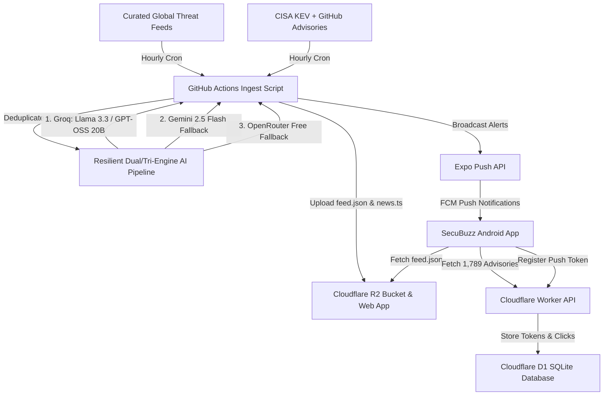

# SecuBuzz: Complete Architectural & Product Status Quo

> **Document Purpose**: This comprehensive status quo dossier details the current architecture, technical stack, threat intelligence pipeline, feature set, design philosophy, telemetry snapshot, and monetization roadmap of **SecuBuzz**. You can copy or feed this document into other AI models (e.g., Claude 3.7, GPT-4o, Gemini 2.5 Pro, DeepSeek R1) to brainstorm features, enterprise extensions, business models, and UX refinements.

---

## 1. Executive Summary & Value Proposition

- **App Name**: SecuBuzz
- **Developer / Publisher**: MiSo Labs
- **Platform**: **Android Native Mobile** via React Native & Expo SDK 57 (Package: `com.secubuzz.app`, **Live on Google Play Store**) + Web Companion ([secubuzz.com](https://secubuzz.com)).
  - *Platform Scope*: **Strictly Android-only**. No iOS build or iOS support is planned to keep operational overhead at $0.00 and maintain laser focus on Android security professionals.
- **Primary Audience**: Cybersecurity analysts, SOC operators, CISOs, DevSecOps engineers, sysadmins, and technology professionals.
- **Core Value Proposition**: 
  1. **Zero Fluff**: Cuts through sensationalist news to deliver factual, objective, actionable 60-word security intelligence briefs.
  2. **Real-Time Threat Telemetry**: Dedicated tracking of active zero-days and emergency directives from the **CISA Known Exploited Vulnerabilities (KEV)** catalog and GitHub Security Advisory Database.
  3. **EPSS Exploit Prediction Integration**: Enriches static CVSS vulnerability scores with daily FIRST.org Exploit Prediction Scoring System (EPSS) probabilities and percentile rankings.
  4. **Anti-AI / Executive Aesthetic**: Clean, dark-mode, sober UI without garish neon gradients or emoji clutter (`🚨⚠️`).
  5. **100% Free Operation ($0.00 Overhead)**: Engineered entirely on top-tier free cloud tiers with $0.00 monthly infrastructure overhead.

---

## 2. Technology Stack & Infrastructure



### Core Frontend Stack
- **Framework**: Expo SDK 57 (`57.0.24`) with React Native (`0.86.3`) and React (`19.2.3`).
- **Target OS**: **Android** (Android 11–15 support, compiled with version code 8 / release 1.0.2).
- **Routing**: Expo Router v57 (file-based navigation with typed routes).
- **Language**: TypeScript 6.0 (`strict: true`, zero `any` leaks).
- **State Management & Persistence**:
  - React Context (`SavedArticlesContext`, `ThemeContext`).
  - `@react-native-async-storage/async-storage` for offline caching of briefs, advisories, bookmarks, preferences, and push tokens.
- **Typography**: `@expo-google-fonts/exo` (Exo Bold, SemiBold, Medium, Regular).
- **Icons**: `@expo/vector-icons` (Ionicons).
- **Sensory & Haptics**: `expo-haptics` (tactile micro-feedback for bookmarking, copying, theme switching, and refresh).
- **Safe Area**: `react-native-safe-area-context` (`v5.7.0`).
- **OTA Updates**: `expo-updates` (`v57.0.23`) with runtime version policy set to `appVersion`.

### Backend & Cloud Infrastructure (100% Free Tier Profile)
| Service | Purpose | Free Quota | Current SecuBuzz Consumption | Headroom |
| :--- | :--- | :--- | :--- | :--- |
| **Cloudflare Worker** (`secubuzz-push`) | API routing, token registry, install tracking & edge caching | 100,000 req/day | ~1,200–3,500 req/day | **96.5% buffer remaining** |
| **Cloudflare D1** (`secubuzz-push-db`) | Serverless SQLite database for push tokens & click analytics | 5,000,000 reads / 100k writes/day | < 50,000 reads / < 50 writes/day | **99.0% database headroom** |
| **Cloudflare R2** (`secubuzz-feed`) | Object storage hosting `feed.json` (~280 KB) | 10 GB storage / 1,000,000 writes/mo | ~30 MB storage / 720 writes/mo | **99.9% free buffer** |
| **Dual/Tri-Engine AI Pipeline** | Summarizing raw RSS feeds into 60-word briefs | Groq (14.4k req/day), Gemini (1,500 req/day) | ~50–120 requests/day | **98.5% API headroom** |
| **GitHub Actions** | Automated CI cron running `scripts/ingest.mjs` hourly | 2,000 min/mo | ~350 min/month (~25s per run) | **82.5% free buffer** |
| **Expo Push Service** | FCM push relay to registered Android devices | Unlimited | Batched in chunks of 100 | **100% free** |

---

## 3. Data Models & Threat Classification

### Article Model (`src/models/article.ts`)
```typescript
export interface Article {
  id: string;                      // Normalized canonical URL or CVE ID
  headline: string;                // Concise, objective editorial headline
  summary: string;                 // 40–60 word security intelligence brief
  sourceName: string;              // Primary publisher (e.g., 'The Hacker News', 'CISA KEV')
  sourceUrl: string;               // Direct canonical link to source advisory
  category: ArticleCategory;       // 'BREACH' | 'RANSOMWARE' | 'CVE' | 'VULNERABILITY' | 'NATION_STATE' | 'GENERAL'
  severity: ArticleSeverity;       // 'CRITICAL' | 'HIGH' | 'MEDIUM' | 'LOW'
  publishedAt: string;             // ISO 8601 timestamp
  // Extended Threat Telemetry:
  requiredAction?: string;         // Mandatory vendor/CISA mitigation action
  dueDate?: string;                // Remediation deadline (e.g., '2026-04-15')
  patchedVersion?: string;         // Fixed software release version
  vulnerableVersionRange?: string; // Vulnerable version scope
  vendorProject?: string;          // Vendor/ecosystem (e.g., 'MikroTik', 'Ivanti', 'Google')
  product?: string;                // Affected software product (e.g., 'RouterOS', 'Chrome')
  additionalSources?: {            // Story clustering & deduplication cross-links
    source: string;
    sourceUrl: string;
  }[];
}
```

### Objective Severity Classification (CVSS & CISA Aligned)
- 🔴 **CRITICAL**: Active in-the-wild zero-day exploitation; unauthenticated Remote Code Execution (RCE) on enterprise infrastructure, firewalls, or OS kernels (CVSS 9.0–10.0); CISA Emergency Directives. (Accent: `#EF4444` Crimson).
- 🟠 **HIGH**: Confirmed major corporate/government data breaches; CVSS 7.0–8.9 with public PoC; active ransomware extortion or nation-state APT campaigns. (Accent: `#F59E0B` Industrial Amber).
- 🟡 **MEDIUM**: Flaws requiring user interaction (phishing, CSRF, reflected XSS); routine scheduled security patches (Patch Tuesday); phishing kit discoveries. (Accent: `#FBBF24` / `#F59E0B` Technical Amber-Yellow — **never green**).
- ⚪ **LOW**: General security surveys, industry quarterly reports, defensive tool releases (CVSS < 4.0). (Accent: `#94A3B8` Muted Slate / Graphite).

---

## 4. Current App Features & Screens

### Tab 1: News Briefs (`src/app/(tabs)/index.tsx`)
- **Vertical Snap Scroll**: Full-viewport paging (TikTok/Reels style vertical paging), presenting 1 self-contained security brief per card.
- **Rolling Archive**: Maintains up to 350 articles (~7–10 days of rolling intelligence across 26 verified sources), refreshed hourly around the clock.
- **Micro-Progress Bar**: Discrete 5-segment progress bar at the top indicating scroll position.
- **Filter Modal**: Filter simultaneously by Threat Severity (`CRITICAL`, `HIGH`, `MEDIUM`, `LOW`) and Category (`BREACH`, `RANSOMWARE`, `CVE`, `NATION_STATE`, `VULNERABILITY`, `GENERAL`).
- **Live Search**: Instant keyword search filtering by title, summary, vendor, product, or CVE ID.
- **Story Deduplication & Cross-Links**: Automatically clusters multiple outlets covering the same event into a single brief with *"Also reported by: [Source 2], [Source 3]"*.
- **Quick Actions**:
  - **1-Tap Markdown Incident Report Copy**: Instantly copies a clean, markdown-formatted incident report to clipboard (with haptic feedback and a 2-second visual checkmark confirmation) formatted for pasting directly into Slack, Microsoft Teams, Jira tickets, or Discord.
  - 1-tap Bookmark/Save with sensory tactile feedback.
  - Native Android Share sheet (generates clean pre-formatted intelligence snippets for Slack, Teams, WhatsApp, X).
  - "Read Original" button opening verified publisher article.
  - Directional "Back to Top" floating button appearing when scrolling upwards.
- **Offline Cache**: Caches feed locally in `AsyncStorage` (`cached-articles`). Works 100% offline.

### Tab 2: Threat Advisories (`src/app/(tabs)/advisories.tsx`)
- **Unified Inventory**: Exactly **1,789 active CVE security advisories** (CISA Known Exploited Vulnerabilities catalog + GitHub Global Security Advisories).
- **EPSS Exploit Prediction Integration**:
  - Displays real-time Exploit Prediction Scoring System (EPSS) probability percentage and global percentile ranking badge (e.g. `EPSS 94.2% · TOP 1%`).
  - **Batch EPSS Pre-fetching**: Efficiently queries FIRST.org in chunked batches of 35 CVEs (`epssService.ts`) for fast rendering without UI stutter.
  - **EPSS Threat Filter**: Filter advisories directly inside the Advisory Filter Modal by exploit likelihood:
    - *All Threat Levels*
    - *Critical Exploit Risk (> 80% / Top 2%)*
    - *High Exploit Risk (> 50% / Top 5%)*
    - *Moderate Exploit Risk (> 20%)*
    - *Low Exploit Risk (< 20%)*
- **Active Telemetry Counter**: Header badge showing dynamic active threat count (`1,789 ACTIVE` or `42 OF 1,789 ACTIVE` when filtered).
- **1-Tap Markdown Advisory Report Copy**: Copies full vulnerability telemetry (CVE ID, severity, EPSS percentile, affected vendor/product, remediation deadline, patch version, required action, and source URL).
- **Remediation & Guidance Card**:
  - Crimson highlight for `REMEDIATION DEADLINE: <Date>` (CISA KEV binding date) or `FIX AVAILABLE: <Version>`.
  - Required mitigation action instructions.
  - Vulnerable version range details.
- **Source Filtering**: Filter between `CISA KEV` and `GITHUB` security advisories.

### Tab 3: Bookmarks / Saved (`src/app/(tabs)/saved.tsx`)
- **Unified Storage**: Persists both News Briefs and Threat Advisories in a permanent offline local list (`secubuzz-saved-articles`).
- **Origin Badges**: Clear tags distinguishing `ADVISORY` (with shield icon) vs `BRIEF` (with newspaper icon).
- **Full Remediation Retention**: When an advisory is opened from Bookmarks, all affected component and remediation details are fully restored.
- **Instant Search**: Search across saved headlines, summaries, and CVEs.

### Tab 4: Settings (`src/app/(tabs)/settings.tsx`)
- **Appearance & Theme**:
  - Theme mode: System Default, Force Dark Mode (`#0B0F14`), Force Light Mode.
  - 6 Curated Architectural Accent Presets:
    1. Classic Cyan (`#4CC9F0`)
    2. Modern Teal (`#06B6D4`)
    3. Cobalt Blue (`#2563EB`)
    4. Matrix Emerald (`#10B981`)
    5. Radar Amber (`#F59E0B`)
    6. Titanium Slate (`#94A3B8`)
- **Notification Preferences**:
  - Alert Channels: Independent toggles for **News Briefs** and **Threat Advisories**.
  - Severity Threshold Selector:
    - *Critical Threats Only* (Active zero-days & CISA emergency directives)
    - *High & Critical (Recommended)* (Major breaches, ransomware, nation-state APTs)
    - *All Security Dispatches* (Includes routine patch bulletins)
  - Client-side filtering via `Notifications.setNotificationHandler`.
- **Data & Storage Manager**:
  - Live local storage measurement (e.g. `Cache: 284.2 KB · Stored offline`).
  - "Clear Cache" button: Flushes temporary news & advisory caches to force a fresh download, while strictly protecting user bookmarks, settings, and push tokens.
- **Support & Compliance**:
  - In-app feedback screen.
  - Privacy Policy and Account Deletion screens compliant with Google Play Store policies.
  - App Version & Build telemetry display (`v1.0.2 · Code 6 / EAS 8`).

---

## 5. Ingestion Engine & Dual-Engine AI Pipeline

### Ingestion Script (`scripts/ingest.mjs`)
- **Schedule**: Runs automatically **every 1 hour** via GitHub Actions (`cron: "17 * * * *"` in `.github/workflows/ingest.yml`), powered by the multi-engine rotation (Groq + Gemini 2.5 Flash + OpenRouter) to deliver rolling, timely security news around the clock without 4-hour gaps.
- **Curated Intelligence Sources**:
  Scrapes 26 top-tier cybersecurity authorities:
  *The Hacker News, BleepingComputer, CISA, Krebs on Security, SANS ISC, Unit 42 (Palo Alto), Zero Day Initiative, The Record, SecurityWeek, Dark Reading, Help Net Security, CyberNews AI, Microsoft Security, Google Security, Sophos Threat Research, Check Point Research, CrowdStrike, The DFIR Report, Wiz Research, Cloudflare Security, Cisco Talos, Trend Micro Research, SentinelOne, Schneier on Security, Malwarebytes Labs, ESET WeLiveSecurity.*
- **Dual/Tri-Engine AI Resiliency**:
  - **Primary**: Groq (`llama-3.3-70b-versatile` / `openai/gpt-oss-20b`) with strict JSON schema outputs and rate-limit backoff listening to `x-ratelimit-reset-tokens`.
  - **Backup 1**: Google Gemini (`gemini-2.5-flash`) fallback if Groq encounters rate limits or service degradation.
  - **Backup 2**: OpenRouter (`openrouter/free`) tertiary fallback.
- **Zero-Day Pipeline**: Checks CISA KEV feed for newly listed CVEs and broadcasts immediately, bypassing LLM processing entirely ($0.00).
- **Anti-AI Slop Guardrails**: Strict prompt constraints eliminating generic AI filler words ("delve", "tapestry", "in today's digital landscape") to produce razor-sharp 60-word briefs.
- **Push Notification Broadcasting**: Relayed via Expo Push Notification Service to registered devices with silent background OTA update handling and URL-safe deep linking.
  - **Zero-Stale-Push Mandate**:
    - **Candidate Ingestion Floor**: RSS candidate items older than 4 days (96h) are discarded before AI processing and marked as seen in `seenUrls`.
    - **Live Feed Invariant**: Push notifications are strictly blocked unless the article is verified present in `mergedFeed`.
    - **24-Hour Freshness Gate**: Broadcasts strictly limited to articles published within the last 24 hours (`<= 24h`).
    - **Ranked Severity Dispatch**: Prioritized by severity (`CRITICAL` > `HIGH` > `MEDIUM` > `LOW`), capped at 2 notifications per cycle with 15s spacing.
    - **CISA KEV Freshness**: Zero-day alerts strictly limited to CVEs added to the KEV catalog within 72 hours (`<= 72h`).

---

## 6. Feed Resilience & Watchdog Architecture

To uphold our **Zero-Silent-Failure Mandate**, SecuBuzz runs a 3-layer automated watchdog:

1. **In-Pipeline Freshness Gate (`scripts/verify_feed_freshness.mjs`)**:
   Runs in CI before R2 upload. Asserts $\ge$ 50 articles and newest story $\le$ 14 hours old; loudly fails CI if the feed is stale.
2. **Autonomous Watchdog Workflow (`.github/workflows/watchdog.yml`)**:
   Runs every 2 hours via GitHub Actions. If the live feed exceeds 6.0 hours old, automatically dispatches an emergency out-of-band `ingest.yml` run.
3. **Edge Health Endpoint (`https://secubuzz.com/health`)**:
   Evaluates live R2 feed age on every request. Returns HTTP 200 with feed telemetry (`articleCount`, `latestHeadline`, `ageHours`, `isFresh`) or HTTP 503 `stale_feed` if > 8.0 hours old.

---

## 7. Live Production Status & Telemetry Snapshot (October 10, 2026)

- **Production Track Status**: **LIVE on the Google Play Store as of October 10, 2026** across 177+ countries and regions.
  - **Store Listing**: [SecuBuzz on Google Play](https://play.google.com/store/apps/details?id=com.secubuzz.app)
  - Passed 14-day closed testing with 100% crash-free sessions across Android 11–15.
  - Production Release `1.0.2` (Version Code 8).
- **Registered Mobile Devices (Cloudflare D1 Push Registry)**: **85 Active Android Devices**
  - App Version breakdown: `v1.0.2`: 22 devices | `v1.0.1`: 33 devices | `v1.0.0`: 30 devices.
  - Total Push Alerts Delivered: **716 alerts**.
- **Daily Edge Traffic (`secubuzz.com`)**: ~1,250–4,200 requests/day across 30+ countries.
- **Install Conversion Telemetry**: Live button-level tracking via `/go/play` with anonymous unique visitor cookie deduplication (`sb_vid`), source button attribution (`home_hero`, `nav`, `footer`), and country-level geo telemetry.

---

## 8. Privacy Architecture & Legal Disclosures

SecuBuzz enforces a strict, transparent two-tier privacy model:

### A. Mobile Application (100% Zero Tracking Guarantee)
- **No Accounts / Logins**: Users do not provide an email, phone number, password, or profile information.
- **Zero Advertising or Commercial SDKs**: No Google AdMob, Facebook SDK, Adjust, or third-party marketing trackers.
- **No Device Identifiers**: Does not collect advertising IDs (GAID/IDFA), MAC addresses, or hardware serials.
- **100% On-Device Data**: All bookmarks, read history, theme choices, and filter preferences reside entirely within local Android `AsyncStorage`.
- **Anonymous Push Tokens**: Push notification tokens are randomized Expo/FCM tokens stored in Cloudflare D1 without any linkage to personal identities or IP addresses.

### B. Web Companion (`secubuzz.com`)
- **Cookie-less Aggregate Analytics**: Uses Cloudflare Web Analytics to measure aggregate visitor counts without cross-site tracking or cookies.
- **Functional Conversion Attribution (Transparently Disclosed in Privacy Policy)**:
  - When a user clicks the "Get on Google Play" button on `secubuzz.com`, a minimal first-party functional cookie (`sb_vid`) containing a randomized UUID is set with `SameSite=Lax`.
  - **Strict Purpose**: Used solely to deduplicate unique versus repeat install button clicks.
  - **No Personal Data**: Does not collect names, emails, browsing history on other sites, or personal information.
  - **Aggregate Country Metrics**: Geographic metrics are recorded strictly at the aggregate country level via standard Cloudflare CDN headers (`cf-ipcountry`) without storing individual IP addresses.
  - **Live Policy**: Fully disclosed and explained at `https://secubuzz.com/privacy`.

---

## 9. API Security Matrix

| Endpoint | Access Level | Description |
| :--- | :---: | :--- |
| `GET /api/news` / `/feed.json` | **Public (HTTP 200)** | Ingested 60-word cybersecurity news briefs (cached 300s). |
| `GET /api/advisories` | **Public (HTTP 200)** | 1,789 active CVE security advisories (CISA KEV + GitHub). |
| `GET /api/epss?cve={ID}` | **Public (HTTP 200)** | FIRST.org EPSS exploit probability proxy (edge-cached 24h). |
| `GET /api/cve-metrics?cve={ID}` | **Public (HTTP 200)** | NIST NVD CVSS vectors proxy (edge-cached 24h). |
| `POST /api/push-tokens` | **Public (HTTP 200)** | Write-only device registration on app install. |
| `GET /health` | **Public (HTTP 200)** | Feed freshness & edge health monitoring. |
| `GET /api/analytics/install-clicks` | **Private (HTTP 401)** | Install button click telemetry & conversions. |
| `GET /api/push-tokens` | **Private (HTTP 401)** | Push token registry management. |
| `POST /api/trigger-ingest` | **Private (HTTP 401)** | Emergency workflow trigger for GitHub Actions. |

*Protected endpoints require `PUSH_ADMIN_SECRET` / `ADMIN_KEY` via `Authorization: Bearer <secret>` or `x-admin-key: <secret>`.*

---

## 10. Product Evolution & Post-Approval Roadmap (The "Threat-to-Action" Pivot)

### The Strategic Vision
Transform SecuBuzz from a **60-word cybersecurity news reader** into a **lightweight, personal threat-intelligence assistant for Android**.

$$\text{News} \longrightarrow \text{CVE} \longrightarrow \text{KEV} \longrightarrow \text{EPSS} \longrightarrow \text{Product / Version} \longrightarrow \textbf{"Am I Affected?"} \longrightarrow \textbf{Action}$$

### Planned Features

#### P0: "My Stack / Am I Affected?" (Personal Threat Radar)
- **Local Technology Watchlist**: Users pick or search for technologies in their enterprise/personal stack (e.g., *Palo Alto PAN-OS, Fortinet FortiOS, Microsoft Exchange, VMware ESXi, WordPress, Apache Tomcat, Atlassian*).
- **On-Device Matching**: Compares local stack entries against `vendorProject` and `product` fields already embedded in our article and CVE models.
- **Customized High-Priority Push Alerts**: Users can elect to be alerted **only** when a threat or advisory affects *their* defined stack.
- **Cost & Privacy**: **100% on-device ($0.00 infrastructure cost)**. Zero personal data or server-side user tracking.

#### P0: One-Tap SOC / Executive Triage Brief
- Generates a pre-formatted, executive incident briefing in Markdown, Slack Block Kit format, or 1-page PDF:
  - Threat summary & impact scope.
  - CVSS score & EPSS in-the-wild exploit probability.
  - CISA KEV exploitation status & binding remediation deadline.
  - Affected versions & vendor patch link.

#### P1: Structured Threat Lifecycle Timeline
- Visual status tracker showing where a vulnerability sits in its lifecycle:
  $$\text{Disclosed} \longrightarrow \text{Public PoC} \longrightarrow \text{Exploited in Wild} \longrightarrow \text{CISA KEV Added} \longrightarrow \text{Patch Available}$$

#### P1: Authoritative NVD CVSS v3.1/v4.0 Vector Strings
- Displays the complete attack vector breakdown (`AV:N/AC:L/PR:N/UI:N/S:U/C:H/I:H/A:H`) with human-readable explanations (Network accessible, No privileges required, No user interaction).

#### P1: Team & Outbound Webhook Integration
- Outbound webhook delivery to Slack, Discord, Microsoft Teams, or PagerDuty for `CRITICAL` alerts or "My Stack" matches.

---

## 11. Monetization Strategy & Packaging (SecuBuzz Pro)

### Core Monetization Principles:
1. **Never Paywall Free News**: The 60-word news briefs and standard CISA KEV advisories remain 100% free forever as the primary organic distribution engine.
2. **Charge for Relevance & Time Saved**: Enterprise practitioners expense tools that save them 30 minutes of daily manual threat triage.
3. **Zero Additional Cloud Overhead**: Pro features execute locally on the client device (SQLite/AsyncStorage) or utilize Cloudflare free edge routes, maintaining an ~85% net margin after Google Play's 15% fee.

### Proposed Packaging

| Tier | Price | Features Included |
| :--- | :---: | :--- |
| **SecuBuzz Free** | **$0.00** | • Full 60-word news feed (26 sources, hourly cycle)<br>• CISA KEV advisories & basic EPSS scores<br>• Standard push alerts & bookmarking |
| **SecuBuzz Pro** | **$2.99 / mo**<br>or **$24.99 / yr**<br>*(or $49.99 Lifetime)* | • **"My Stack"** custom technology radar (unlimited vendors)<br>• **Stack-filtered Push Alerts** (alerts only for your infrastructure)<br>• **1-Tap SOC / Executive Triage Brief** copy & export<br>• **Threat Lifecycle Timelines**<br>• **Advanced Multi-Filter CVE Vault** |
| **SecuBuzz Team** *(Future B2B)* | **$9.99 / mo** | • Outbound Slack / Discord / Teams Webhook alerts<br>• Multi-user stack sharing |
| **Cloudflare Monetization Gateway** | **Per-Request Micropayment** | • Paywall third-party commercial AI bots, LLM crawlers, and automated MCP consumers querying `secubuzz.com` feeds. |

---

## 12. Prompts for Consulting Other AI Models

You can paste this entire document into Claude 3.7, GPT-4o, or Gemini 2.5 Pro along with the following prompt:

```markdown
I have built and released a production-grade cybersecurity intelligence Android mobile application called "SecuBuzz" (React Native / Expo SDK 57, TypeScript, Cloudflare R2/Worker/D1, Groq + Gemini AI dual pipeline, GitHub Actions, 100% $0.00 monthly cost, Live on Google Play).

Read the attached complete status quo document. I want you to act as an elite Staff Mobile Architect and Cybersecurity Venture Product Lead.

Please review our architecture and provide detailed critique and expansion on:
1. Product Evolution & Paid Features: Review our proposed "SecuBuzz Pro" feature set (My Stack, SOC Triage Brief, Threat Timelines). What additional paid features would CISOs, SOC analysts, and security engineers gladly expense to their corporate credit cards?
2. Android UX & Information Architecture: How can we present complex threat intelligence (EPSS percentiles, CVSS vectors, CISA KEV deadlines, My Stack alerts) on Android screens with maximum clarity and zero cognitive clutter?
3. B2B & Team Expansion: What is the most seamless way to transition from single-user mobile Pro subscriptions into high-margin team subscriptions (Slack bots, SIEM webhooks, shared watchlists) without ballooning server costs?
4. Technical Edge Hardening: Any optimizations or blind spots in our 100% free-tier Cloudflare + GitHub Actions + Expo architecture?
```
