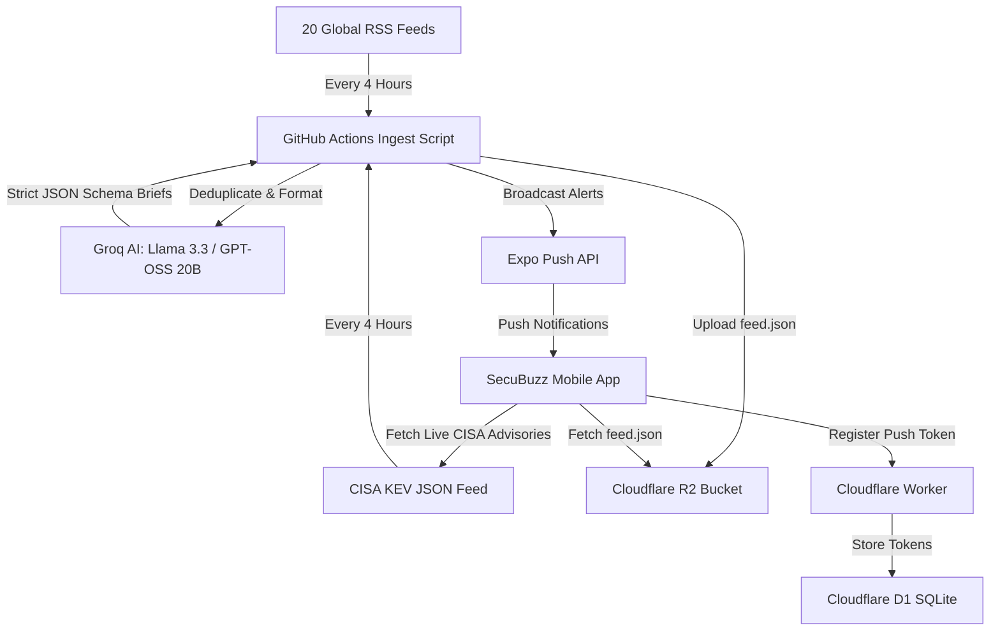

# SecuBuzz: Complete Architectural & Product Status Quo

> **Document Purpose**: This comprehensive status quo dossier details the current architecture, technical stack, threat intelligence pipeline, feature set, design philosophy, and operational cost profile of **SecuBuzz**. You can copy or feed this document into other AI models (e.g., Claude, GPT-4o, Gemini Pro) to brainstorm features, business models, enterprise extensions, and UX refinements.

---

## 1. Executive Summary & Value Proposition

- **App Name**: SecuBuzz
- **Developer / Publisher**: MiSo Labs
- **Platform**: Cross-platform Mobile (Android & iOS) via React Native & Expo SDK 57
- **Primary Audience**: Cybersecurity analysts, SOC operators, CISOs, DevSecOps engineers, sysadmins, and technology professionals.
- **Core Value Proposition**: 
  1. **Zero Fluff**: Cuts through sensationalist news to deliver factual, actionable 60-word security briefs.
  2. **Real-Time Threat Telemetry**: Dedicated tracking of active zero-days and emergency directives from the **CISA Known Exploited Vulnerabilities (KEV)** catalog.
  3. **Anti-AI / Executive Aesthetic**: Clean, dark-mode, sober UI without garish neon gradients or emoji clutter (`🚨⚠️`).
  4. **100% Free Operation**: Engineered entirely on top-tier free cloud tiers with $0.00 monthly infrastructure overhead.

---

## 2. Technology Stack & Infrastructure



### Core Frontend Stack
- **Framework**: Expo SDK 57 (`57.0.24`) with React Native (`0.86.3`) and React (`19.2.3`).
- **Routing**: Expo Router v57 (file-based navigation with typed routes).
- **Language**: TypeScript 6.0 (`strict: true`, zero `any` leaks).
- **State Management & Persistence**:
  - React Context (`SavedArticlesContext`, `ThemeContext`).
  - `@react-native-async-storage/async-storage` for offline caching of briefs, advisories, bookmarks, preferences, and push tokens.
- **Typography**: `@expo-google-fonts/exo` (Exo Bold, SemiBold, Medium, Regular).
- **Icons**: `@expo/vector-icons` (Ionicons).
- **Safe Area**: `react-native-safe-area-context` (`v5.7.0`).
- **OTA Updates**: `expo-updates` (`v57.0.23`) with runtime version policy set to `appVersion`.

### Backend & Cloud Infrastructure (100% Free Tier Profile)
| Service | Purpose | Free Quota | Current SecuBuzz Consumption | Headroom |
| :--- | :--- | :--- | :--- | :--- |
| **Cloudflare Worker** (`secubuzz-push`) | Token registration & static policy endpoints | 100,000 req/day | ~20–50 req/day | **99.95% free** |
| **Cloudflare D1** (`tokens`) | Serverless SQLite database for device push tokens | 100,000 writes/day | < 15 writes/day | **99.98% free** |
| **Cloudflare R2** (`secubuzz-feed`) | Object storage hosting `feed.json` (~180 KB) | 1,000,000 writes/mo | 180 writes/month (6x/day) | **99.98% free** |
| **Groq AI API** | Summarizing raw RSS feeds into 60-word briefs | 14,400 req/day | ~48 req/day | **99.66% free** |
| **CISA KEV Catalog** | Direct JSON threat advisory feed | Public / Unlimited | Direct HTTP fetch ($0.00) | **100% free** |
| **GitHub Actions** | Automated CI cron running `scripts/ingest.mjs` | 2,000 min/mo | ~135 min/month (~40s per run) | **93.25% free** |
| **Expo Push Notification Service** | APNs & FCM push relay | Unlimited | Batched in chunks of 100 | **100% free** |

---

## 3. Data Models & Threat Classification

### Article Model (`src/models/article.ts`)
```typescript
export interface Article {
  id: string;                      // Normalized canonical URL or CVE ID
  headline: string;                // Concise, objective editorial headline
  summary: string;                 // 40–60 word security intelligence brief
  sourceName: string;              // Primary publisher (e.g., 'The Hacker News', 'CISA KEV')
  sourceUrl: string;               // Direct canonical link to source advisory
  category: ArticleCategory;       // 'BREACH' | 'RANSOMWARE' | 'CVE' | 'VULNERABILITY' | 'NATION_STATE' | 'GENERAL'
  severity: ArticleSeverity;       // 'CRITICAL' | 'HIGH' | 'MEDIUM' | 'LOW'
  publishedAt: string;             // ISO 8601 timestamp
  // Extended Threat Telemetry for Advisories:
  requiredAction?: string;         // Mandatory vendor/CISA mitigation action
  dueDate?: string;                // Remediation deadline (e.g., '2026-04-15')
  patchedVersion?: string;         // Fixed software release version
  vulnerableVersionRange?: string; // Vulnerable version scope
  vendorProject?: string;          // Vendor/ecosystem (e.g., 'MikroTik', 'Ivanti', 'Google')
  product?: string;                // Affected software product (e.g., 'RouterOS', 'Chrome')
}
```

### Objective Severity Classification (CVSS & CISA Aligned)
- 🔴 **CRITICAL**: Active in-the-wild zero-day exploitation; unauthenticated Remote Code Execution (RCE) on enterprise infrastructure, firewalls, or OS kernels (CVSS 9.0–10.0); CISA Emergency Directives. (Accent: `#EF4444`).
- 🟠 **HIGH**: Confirmed major corporate/government data breaches; CVSS 7.0–8.9 with public PoC; active ransomware extortion or nation-state APT campaigns. (Accent: `#F59E0B`).
- 🟡 **MEDIUM**: Flaws requiring user interaction (phishing, CSRF, reflected XSS); routine scheduled security patches (Patch Tuesday); phishing kit discoveries. (Accent: `#10B981`).
- ⚪ **LOW**: General security surveys, industry quarterly reports, defensive tool releases (CVSS < 4.0). (Accent: `#64748B`).

---

## 4. Current App Features & Screens

### Tab 1: News Briefs (`src/app/(tabs)/index.tsx`)
- **Vertical Snap Scroll**: Full-viewport paging (TikTok/Reels style vertical paging), showing 1 self-contained security brief per card.
- **Micro-Progress Bar**: Discrete 5-segment progress bar at the top indicating scroll position.
- **Filter Modal**: Filter simultaneously by Threat Severity (`CRITICAL`, `HIGH`, `MEDIUM`, `LOW`) and Category (`BREACH`, `RANSOMWARE`, `CVE`, `NATION_STATE`, `VULNERABILITY`, `GENERAL`).
- **Live Search**: Instant keyword search filtering by title, summary, vendor, or CVE ID.
- **Quick Actions**:
  - **1-Tap Markdown Incident Report Copy**: Instantly copies a clean, markdown-formatted incident report to clipboard (with a 2-second visual checkmark confirmation) formatted for pasting directly into Slack, Microsoft Teams, Jira tickets, or Discord.
  - 1-tap Bookmark/Save with visual state transition.
  - Native Share sheet (generates clean pre-formatted intelligence snippets for Slack, Teams, WhatsApp, X).
  - "Read Original" button opening in-app / external source.
  - Directional "Back to Top" floating button appearing when scrolling upwards.
- **Feed Cache**: Caches up to 250 stories locally in `AsyncStorage` (`cached-articles`). Works 100% offline.

### Tab 2: Threat Advisories (`src/app/(tabs)/advisories.tsx`)
- **Direct CISA KEV Ingestion**: Ingests active zero-days from CISA's live catalog.
- **Active Telemetry Counter**: Header badge showing dynamic active threat count (`25 ACTIVE` or `6 OF 25 ACTIVE` when filtered).
- **1-Tap Markdown Advisory Report Copy**: Copies full vulnerability telemetry (CVE ID, severity, affected vendor/product, remediation deadline, patch version, required action, and source URL) in Markdown for security team channels.
- **Affected Component Banner**: Dedicated banner highlighting `AFFECTED: Vendor · Product` with micro cube icon.
- **Remediation & Guidance Card**:
  - Crimson highlight for `REMEDIATION DEADLINE: <Date>` (CISA KEV binding date) or `FIX AVAILABLE: <Version>`.
  - Required mitigation action instructions.
  - Vulnerable version range details.
- **Source Filtering**: Filter between `CISA KEV` and `GITHUB` security advisories.

### Tab 3: Bookmarks / Saved (`src/app/(tabs)/saved.tsx`)
- **Unified Storage**: Persists both News Briefs and Threat Advisories in a permanent offline local list (`secubuzz-saved-articles`).
- **Origin Badges**: Clear tags distinguishing `ADVISORY` (with shield icon) vs `BRIEF` (with newspaper icon).
- **Full Remediation Retention**: When an advisory is opened from Bookmarks, all affected component and remediation details are fully restored.
- **Instant Search**: Search across saved headlines, summaries, and CVEs.

### Tab 4: Settings (`src/app/(tabs)/settings.tsx`)
- **Appearance & Theme**:
  - Theme mode: System Default, Force Dark Mode, Force Light Mode.
  - 6 Curated Architectural Accent Presets:
    1. Classic Cyan (`#4CC9F0`)
    2. Modern Teal (`#06B6D4`)
    3. Cobalt Blue (`#2563EB`)
    4. Matrix Emerald (`#10B981`)
    5. Radar Amber (`#F59E0B`)
    6. Titanium Slate (`#94A3B8`)
- **Notification Preferences**:
  - Alert Channels: Independent toggles for **News Briefs** and **Threat Advisories**.
  - Severity Threshold Selector:
    - *Critical Threats Only* (Active zero-days & CISA emergency directives)
    - *High & Critical (Recommended)* (Major breaches, ransomware, nation-state APTs)
    - *All Security Dispatches* (Includes routine patch bulletins)
  - Client-side filtering via `Notifications.setNotificationHandler`.
- **Data & Storage Manager**:
  - Live local storage measurement (e.g. `Cache: 184.2 KB · Stored offline`).
  - "Clear Cache" button: Flushes temporary news & advisory caches to force a fresh download, while strictly protecting user bookmarks, settings, and push tokens.
- **About & Support / Legal**:
  - In-app feedback screen.
  - Privacy policy and account deletion screens compliant with Google Play Store policies.

---

## 5. Ingestion & Push Notification Engine

### Ingestion Script (`scripts/ingest.mjs`)
- Runs every 4 hours via GitHub Actions workflow (`.github/workflows/ingest.yml`).
- Scrapes 20 top-tier cybersecurity RSS sources:
  *The Hacker News, BleepingComputer, CISA, Krebs on Security, SANS ISC, Unit 42 (Palo Alto), Zero Day Initiative, The Record, SecurityWeek, Dark Reading, Help Net Security, CyberNews AI, Microsoft Security, Google Security, Sophos Threat Research, Check Point Research, CrowdStrike, The DFIR Report, Wiz Research, Cloudflare Security.*
- **Deduplication Engine**: Uses `seen-urls.json` and existing `feed.json` (max 250 articles) so previously ingested articles are never processed again.
- **Multi-Source Diversity**: Caps at 2 articles per publisher in the first pass to guarantee varied threat coverage.
- **Groq AI Pipeline**: Batches 2 articles per request with strict JSON schema outputs (`GROQ_RESPONSE_SCHEMA`) and automated rate-limit backoff listening to `x-ratelimit-reset-tokens`.
- **Zero-Day Pipeline**: Checks CISA KEV feed for newly listed CVEs and broadcasts immediately, bypassing Groq entirely ($0.00).

### Push Notification Branding
- Push titles follow a clean, sober standard:
  - `SecuBuzz · BRIEF [HIGH]` or `SecuBuzz · BRIEF [CRITICAL]`
  - `SecuBuzz · ADVISORY [CRITICAL]` or `SecuBuzz · ADVISORY [CRITICAL - RANSOMWARE]`
- No emoji clutter (`🚨⚠️`).
- Relayed via Expo Push Notification Service to Google FCM and Apple APNs.

---

## 6. Architecture Highlights & Guardrails

1. **Rule 2: Senior Engineering / OTA Update Priority**:
   - UI, TypeScript, and layout changes are deployed over-the-air via `eas update --branch production`.
   - Native builds (`.aab`) are strictly reserved for native permissions or config changes.
2. **Rule 4: Sober / Anti-AI Aesthetics**:
   - Micro-dot telemetry (5px).
   - Crisp 4px architectural corners.
   - Dynamic crimson accent divider (`#EF4444`) on `CRITICAL` stories.
3. **Catch-All Deep Linking**:
   - Catch-all route [`src/app/article/[...id].tsx`](file:///c:/SecuBuzz/src/app/article/[...id].tsx) preserves double-slash protocol integrity (`https://` instead of collapsing into `https:/`).

---

## 7. Strategic Brainstorming Prompts for Other AI Models

You can copy and paste the prompt below into any other AI model (Claude 3.7, GPT-4o, Gemini 2.5 Pro, DeepSeek R1) along with this document:

```markdown
I have a production-grade, 100% free-tier cybersecurity news and CISA KEV threat advisory mobile app called "SecuBuzz" (React Native / Expo SDK 57, Groq AI, Cloudflare R2/Worker/D1, GitHub Actions). 

Review the attached status quo document. I want you to act as an elite Principal Mobile Product Manager and Staff Cybersecurity Architect. 

Please provide creative, high-impact suggestions across these 4 areas:
1. High-Utility Features for Security Professionals: What specific features (e.g. personal asset watchlists, STIX/TAXII export, IOC extraction, CVSS calculators) would make SecuBuzz an indispensable daily tool for security engineers and SOC analysts?
2. Monetization & Sustainability without Paywalling: The core intelligence must remain free for everyone. What non-intrusive monetization models (e.g., enterprise team sync, sponsored security tools, premium automated CVE alerts for custom vendor tech stacks) would work best?
3. Community & Interactive Capabilities: How can we introduce engagement (e.g., vulnerability impact polls, "Am I Affected?" company self-checks, community mitigations) while maintaining our strict "no-noise / sober" design standard?
4. Technical Scalability & Data Sources: Based on our 100% free cloud architecture, what additional free threat intelligence feeds or APIs (e.g. NVD, GitHub Advisory Database, AlienVault OTX, Pulsedive) should we integrate next?
```
